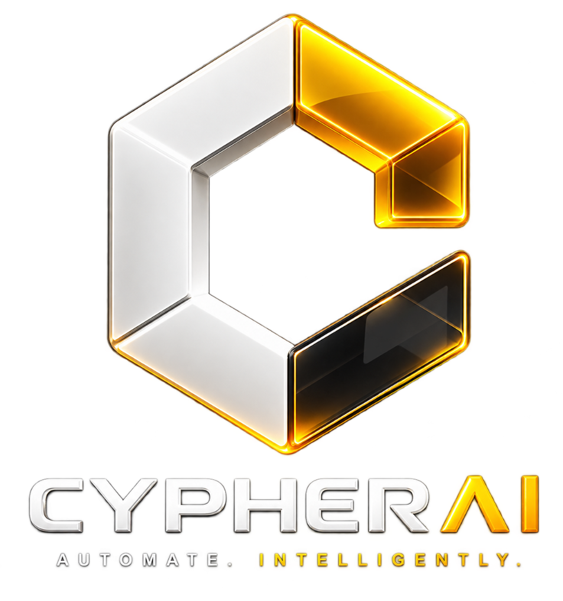
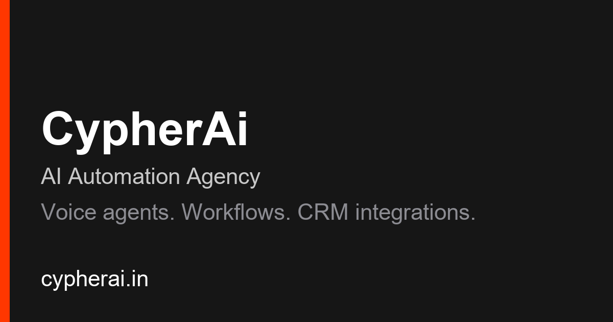

<p align="center">
  <a href="https://www.cypherai.in">
    
  </a>
</p>

<h1 align="center">CypherAi — Bespoke AI Automation & Intelligent Systems</h1>

<p align="center">
  <b>Production-grade autonomous voice agents, custom n8n & Make workflows, CRM integrations, and Generative Engine Optimization (GEO).</b>
</p>

<p align="center">
  <a href="https://www.cypherai.in"></a>
  
  
  
  
</p>

<p align="center">
  
</p>

---

## ⚡ Overview

**CypherAi** (`cypherai.in`) is an AI automation agency founded by **Priyansh Razz**, engineering intelligent systems, autonomous voice callers, and enterprise workflow pipelines for modern brands and startups.

This repository hosts the **high-performance static web application, service infrastructure, mobile mirror generation pipeline, and automated SEO/GEO test suite** powering [https://www.cypherai.in](https://www.cypherai.in).

### Key Technical Achievements
- **Eradicated Staging Canonical Leaks:** Eliminated 35 hardcoded Framer staging domain links (`kind-fruit-367546.framer.app`), executing a clean cutover to `https://www.cypherai.in/`.
- **4 Comprehensive Service Hubs:** Built over 8,200 words of high-density, authoritative content across Voice Agents, Workflows, CRM Integrations, and AI SEO.
- **15/15 Mobile Mirror Parity:** Automated phone mirror generator (`site/m/`) with zero byte drift outside marker blocks and automatic desktop crawler bypass.
- **45+ Automated SEO & Schema Gates:** Zero-dependency automated test suite (`scripts/check-seo.mjs`) ensuring 100% compliance with title/meta lengths, sitemap coverage, and Schema.org rules.
- **Generative Engine Optimization (GEO):** Optimized for citation across **ChatGPT Search**, **Perplexity AI**, and **Google AI Overviews** with machine-readable `llms.txt`, verified JSON-LD graphs, and a GS1-style Claim Provenance Ledger.

---

## 🛠️ The 3-Step Execution Model

CypherAi delivers enterprise-grade automations in focused **2 to 4-week deployment sprints**:

<table align="center" width="100%">
  <tr>
    <th width="33%" align="center"><h3>1. Enquire &amp; Map</h3></th>
    <th width="33%" align="center"><h3>2. Architect &amp; Build</h3></th>
    <th width="33%" align="center"><h3>3. Deploy &amp; Operate</h3></th>
  </tr>
  <tr>
    <td align="center">
      
    </td>
    <td align="center">
      
    </td>
    <td align="center">
      
    </td>
  </tr>
  <tr>
    <td valign="top">
      <ul>
        <li>45-minute discovery consultation</li>
        <li>Bottleneck &amp; SOP process mapping</li>
        <li>Fixed-price quote within 48 hours</li>
        <li>Stack selection (GPT-4o, Claude, n8n)</li>
      </ul>
    </td>
    <td valign="top">
      <ul>
        <li>Sub-second latency voice caller engineering</li>
        <li>Event-driven webhooks &amp; n8n logic</li>
        <li>Bi-directional CRM integration sync</li>
        <li>Human-in-the-loop review guardrails</li>
      </ul>
    </td>
    <td valign="top">
      <ul>
        <li>Production telephone &amp; API line launch</li>
        <li>24/7 call qualification &amp; booking</li>
        <li>PostgreSQL logging &amp; error alerts</li>
        <li>Quarterly model evaluation &amp; SLA review</li>
      </ul>
    </td>
  </tr>
</table>

---

## 🏛️ Service Pillars & Route Map

| Pillar / URL | Focus &amp; Capability | Word Count | Schema Types | Status |
|---|---|---|---|---|
| **[AI Voice Agents](site/voice-agents/index.html)**<br/>`/voice-agents/` | 24/7 inbound &amp; outbound callers, sub-second latency, Twilio + ElevenLabs + GPT-4o stack, appointment booking. | **2,177 words** | `Service`, `WebPage`, `BreadcrumbList` | `200 OK` |
| **[AI Workflows](site/workflows/index.html)**<br/>`/workflows/` | Custom n8n &amp; Make automation pipelines, document extraction, SOP automation, human-in-the-loop gates. | **2,122 words** | `Service`, `WebPage`, `BreadcrumbList` | `200 OK` |
| **[CRM Integrations](site/crm-integrations/index.html)**<br/>`/crm-integrations/` | Bi-directional data sync across HubSpot, Salesforce, GoHighLevel, Airtable, WhatsApp API, and Slack. | **1,822 words** | `Service`, `WebPage`, `BreadcrumbList` | `200 OK` |
| **[AI SEO Services](site/seo/index.html)**<br/>`/seo/` | Technical SEO audits, Generative Engine Optimization (GEO), AI Overview citability, question-form H2s. | **2,100+ words** | `Service`, `WebPage`, `BreadcrumbList` | `200 OK` |
| **[Proof &amp; Methodology](site/seo/proof/index.html)**<br/>`/seo/proof/` | GS1-style Claim Provenance Ledger (claims C-01 to C-06), freshness SLAs, changelog, and verification URLs. | **950+ words** | `WebPage`, `BreadcrumbList` | `200 OK` |
| **[Book Consultation](site/contact/index.html)**<br/>`/contact/` | Interactive booking form with multi-service selector, calendar picker, and direct WhatsApp / email routing. | **1,700+ lines** | `ContactPage`, `WebPage` | `200 OK` |
| **[Case Studies](site/work/index.html)**<br/>`/work/` | Production case studies covering Bravo (UI/UX App), Nitro (Design System), Strida, and custom enterprise setups. | **6 Case Studies** | `CollectionPage`, `WebPage` | `200 OK` |

---

## 📂 Project Architecture

```
CypherAi-main/
├── DESIGN.md                          # Swiss Industrial Precision design system & CRM UI tokens
├── CypherAi_SEO_Audit_Summary.pdf     # 5-Page Executive Technical Report (ReportLab)
├── package.json                       # Scripts for dev, test, and mirror build
├── server.mjs                         # Node.js HTTP server (tiered caching, mobile UA-split, XML MIME)
├── .gitignore                         # Strict repository exclusions
│
├── scripts/
│   ├── build-mobile.mjs               # Phone mirror generator with git HEAD parity validation
│   ├── check-seo.mjs                  # Automated 45+ rule SEO gate checker
│   └── generate-pdf.py                # Standalone script for building the 5-page PDF report
│
├── specs/seo-foundation/
│   ├── spec.md                        # Master project specification
│   ├── plan.md                        # Implementation plan & architecture
│   ├── tasks.md                       # Task execution registry with audit dates
│   ├── research.md                    # 8 locked decisions & constitution check
│   ├── data-model.md                  # Entity definitions & claim state transitions
│   ├── design-review.md               # 21-dimension design audit record
│   ├── quickstart.md                  # Runnable command validation guide
│   └── contracts/
│       ├── route-contract.md          # 14-route HTTP behavior contract
│       ├── head-contract.md           # <head> tag rules per page class
│       └── mirror-contract.md         # /m/ mobile mirror anatomy & parity rules
│
└── site/                              # Shippable web application root
    ├── robots.txt                     # Crawler directives (allows Google, OAI-SearchBot, PerplexityBot)
    ├── sitemap.xml                    # Production XML sitemap (14 clean routes)
    ├── llms.txt                       # 2026 standard machine-readable LLM context & entity file
    ├── index.html                     # Homepage (Framer export with JSON-LD Organization)
    ├── 404/index.html                 # Hardened 404 error page (<meta robots="noindex, follow">)
    ├── contact/index.html             # High-conversion booking portal
    ├── work/                          # Portfolio hub & 6 detailed case study exports
    ├── seo/                           # AI SEO & GEO commercial hub
    ├── seo/proof/                     # Claim Provenance Ledger warehouse
    ├── voice-agents/                  # AI Voice Agents service hub
    ├── workflows/                     # AI Workflow Automation service hub
    ├── crm-integrations/              # CRM Integrations service hub
    ├── m/                             # 15 phone mirrors generated by build-mobile.mjs
    ├── overlay/                       # Hide-edit affordance scripts
    └── images/                        # Logos, OG cover cards, process illustrations
```

---

## 🧪 Testing & Automated Verification

CypherAi maintains zero tolerance for SEO regressions, staging leaks, or viewport overflows.

### 1. Run the SEO Gate Suite (45+ Automated Checks)
```bash
npm run check:seo
```
- Asserts **0 staging references** across all HTML, XML, TXT, and JSON files.
- Asserts strict title (`30–70ch`) and description (`100–175ch`) length limits.
- Asserts `canonical == og:url == sitemap loc == JSON-LD url`.
- Validates clean JSON-LD parsing with allowlisted types (`Organization`, `WebSite`, `Service`, `BreadcrumbList`, `ListItem`, `Person`).
- Ensures zero deprecated `HowTo` or restricted `FAQPage` schemas exist.
- Asserts exact 14/14 route sitemap coverage.

### 2. Verify Mobile Mirror Parity (15/15 PASS)
```bash
npm run build:mobile -- --check
```
- Validates that every mirror file in `site/m/` is byte-identical to its desktop counterpart outside the marker block `<!-- cypher-phone:begin -->` ... `<!-- cypher-phone:end -->`.
- Guarantees search engine crawlers always get the clean desktop HTML, while mobile users receive the touch-optimized viewport.

---

## 🚀 Local Development

### Prerequisites
- **Node.js**: v20 or higher (stdlib only; zero npm dependencies required).
- **Python**: v3.10+ with `reportlab` and `Pillow` (only if regenerating the PDF summary).

### Quick Start
```bash
# 1. Clone the repository
git clone https://github.com/your-org/CypherAi.git
cd CypherAi

# 2. Start the local server
npm run dev

# 3. Open in browser
# Local Preview: http://127.0.0.1:3000
```

### Server Architecture (`server.mjs`)
- **Clean URL Resolution:** Maps directory paths (e.g., `/seo/`, `/voice-agents/`) to their respective `index.html` files.
- **Tiered Cache Headers:**
  - Content-hashed vendor assets (`.woff2`, Framer chunks, `.mjs`): `public, max-age=31536000, immutable`.
  - Site assets (`.css`, `.png`, `.jpg`, `.svg`): `public, max-age=3600`.
  - HTML documents: `cache-control: no-cache` (always fresh on deploy).
- **Mobile User-Agent Split:** Transparently serves `site/m/` to phone clients while forcing desktop for all search engine bots and tablets.

---

## 🎨 Design System (`DESIGN.md`)

The repository includes a dedicated design system specification: **[`DESIGN.md`](DESIGN.md)**.

Engineered for building companion internal tools, client portals, and CRMs, it encodes:
- **Color Calibration:** Pitch Charcoal (`#161616`), Surface Fill (`#F6F6F6`), Subtle Divider (`#ECECEC`), and Cypher International Orange (`#FF3700`).
- **Data Density Standards:** Tabular monospace (`JetBrains Mono`, `Geist Mono`) for all financial, duration, and latency metrics.
- **Component Primitives:** Button depression states (`translateY(1px)`), responsive data tables with touch scroll-wraps, left-accent KPI stat cards, and status pills.
- **Banned AI Tells:** Explicitly bans generic emojis, purple/blue glowing halos, low-contrast placeholder text, and full-screen circular spinners.

---

## 📊 Executive Summary PDF

A publication-grade, 5-page PDF executive summary is available for clients and stakeholders:
👉 **[`CypherAi_SEO_Audit_and_Overhaul_Summary.pdf`](CypherAi_SEO_Audit_and_Overhaul_Summary.pdf)**

To regenerate the PDF after updating metrics or content:
```bash
python scripts/generate-pdf.py
```

---

## 🚢 Production Deployment Checklist

When deploying changes to production hosting (Vercel, Cloudflare Pages, AWS, VPS):

1. **Host-Level 301 Redirect:** Configure DNS/CDN to permanently redirect all apex requests (`https://cypherai.in/*`) to the canonical host (`https://www.cypherai.in/*`).
2. **Search Console Submission:** In Google Search Console, submit `https://www.cypherai.in/sitemap.xml`.
3. **Inspect Core Hubs:** Request indexing for `/`, `/seo/`, `/voice-agents/`, `/workflows/`, and `/crm-integrations/`.
4. **Run PageSpeed Baseline:** Verify Core Web Vitals on live production URLs (`LCP ≤ 2.5s`, `INP ≤ 200ms`, `CLS ≤ 0.1`).

---

## 📬 Contact & Inquiries

- **Founder:** Priyansh Razz, AI Automation Specialist
- **Direct WhatsApp:** [+91 95824 40495](https://wa.me/919582440495)
- **Consultation Portal:** [https://www.cypherai.in/contact/](https://www.cypherai.in/contact/)
- **Website:** [https://www.cypherai.in](https://www.cypherai.in)

---

<p align="center">
  <sub>© 2026 Cypher Ai. Built with industrial precision. Not affiliated with cypherai.ai, cypherbio.ai, or cypherai.asia.</sub>
</p>
